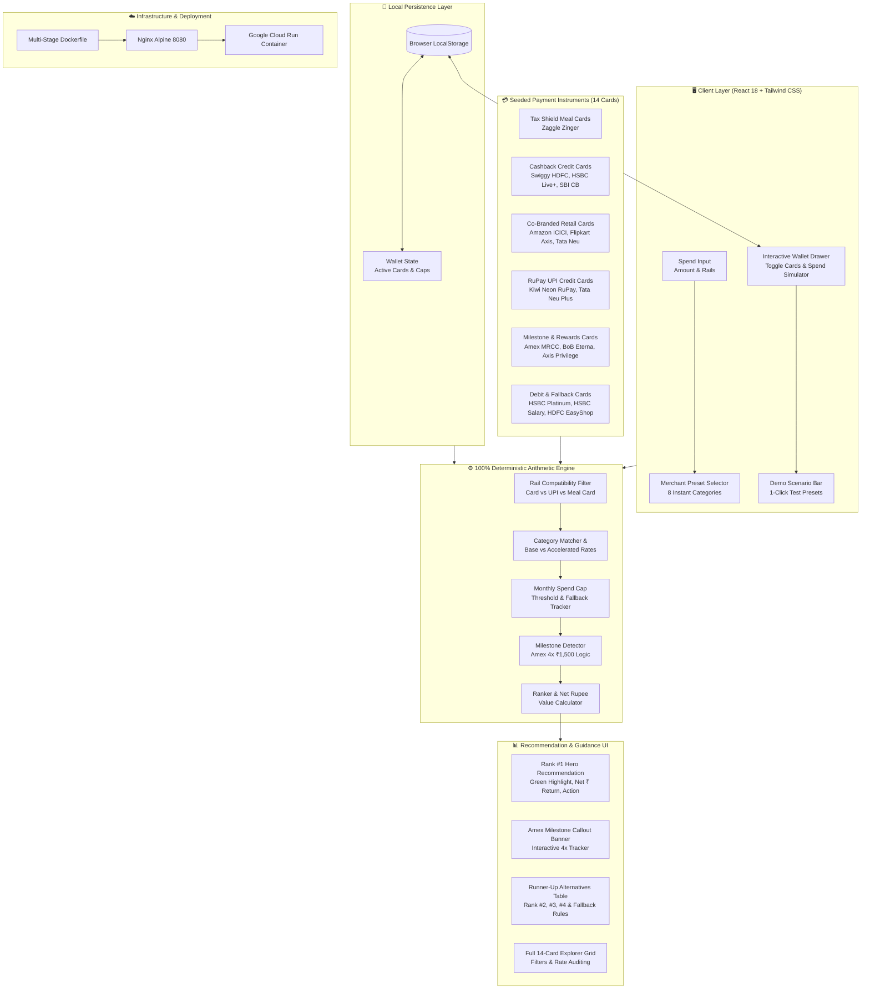

# 💳 CardWise: Personal Spend & Reward Optimizer

<div align="center">

### A 100% Deterministic Arithmetic Engine & Visual Spend Decision Optimizer
*Never leave reward points or tax shields on the table.*

[](https://reactjs.org/)
[](https://vitejs.dev/)
[](https://tailwindcss.com/)
[](https://www.typescriptlang.org/)
[](https://cloud.google.com/run)
[](LICENSE)

</div>

---

## 📌 Overview

**CardWise** is a personal spend and payment optimization web application designed to solve credit card reward complexity in India. 

Modern portfolios mix **tax-deductible meal cards**, **accelerated merchant credit cards**, **RuPay cards on UPI**, and **spend-milestone cards**. Cardholders lose thousands of rupees every year by tapping the wrong card, scanning UPI with standard bank accounts, or exceeding monthly accelerated cashback caps without knowing.

CardWise provides a **zero-hallucination, 100% deterministic arithmetic engine** that:
1. Evaluates payment rails (`Card`, `RuPay UPI`, `Meal Card`).
2. Accounts for remaining monthly accelerated spend caps.
3. Exploits direct pre-tax meal card allowances (~30% direct tax shielding).
4. Unlocks high-yield milestone bonuses (e.g. Amex MRCC 4x ₹1,500 transactions).
5. Ranks every instrument by **net Rupee value returned**.

---

## 🏗️ Architecture Diagram



---

## ✨ Features Currently Implemented

### 1. 🧮 100% Deterministic Arithmetic Engine
- **Zero Hallucination Guarantee**: All rate calculations, thresholds, and condition tags are computed strictly via transparent math.
- **Dynamic Cap Exhaustion & Fallback**: If a card's monthly accelerated limit is reached (e.g., HSBC Live+ ₹1,000 cap or Swiggy HDFC ₹1,500 cap), the engine automatically calculates returns at the card's base rate and flags the runner-up options.

### 2. 🛡️ Meal Card Tax Shield Priority
- Identifies food and grocery merchants (Swiggy, Zomato, Instamart, Zepto, Blinkit, Supermarkets).
- Ranks the **Zaggle Zinger Meal Card** at a direct ~30% tax-shield savings rate based on configurable income tax slabs (20%, 30%, 39% HNI).
- Provides guidance: *"Saves 30% via pre-tax allowance if balance is available; otherwise use Swiggy HDFC (10%) or HSBC Live+ (10%)."*

### 3. 📲 RuPay UPI Scan & Pay Isolation
- Switching the payment rail to **UPI Scan & Pay** instantly isolates eligible RuPay cards:
  - **Kiwi Neon RuPay**: #1 with 2% instant cashback.
  - **Tata Neu Plus HDFC**: #2 with 1% NeuCoins on UPI (7% on Tata brands).
- Displays clear alert warnings explaining why Visa, Mastercard, and Amex cards cannot scan merchant UPI QRs.

### 4. 🎯 Amex MRCC Milestone Intelligence
- Evaluates transactions between **₹1,500 and ₹2,000**.
- Automatically launches the **Amex Milestone Pro-Tip Banner**.
- Features an interactive **4x ₹1,500 Monthly Tracker** illustrating how completing the milestone yields 1,000 bonus points (~6.6% to 16% effective return).

### 5. 💳 Built-in 14 Payment Instruments
Pre-loaded with exact rates, caps, and networks:
1. **Zaggle Zinger Meal Card** *(Meal Card / Free / 30% tax shield on food)*
2. **Swiggy HDFC** *(Mastercard / LTF / 10% Swiggy, 5% partners, ₹1,500 cap)*
3. **HSBC Live+** *(Visa / ₹1,000 fee / 10% Dining & Groceries, ₹1,000 cap)*
4. **SBI Cashback** *(Visa / ₹1,000 fee / 5% online shopping, ₹5,000 cap)*
5. **Amazon Pay ICICI** *(Visa / LTF / 5% unlimited Amazon Prime, 2% bills)*
6. **BoB Eterna** *(Visa / LTF / 3.75% travel, dining & international, ₹1,250 cap)*
7. **Flipkart Axis Bank** *(Visa & MC / ₹500 fee / 5% Flipkart & Cleartrip, 4% partners)*
8. **Kiwi Neon RuPay** *(RuPay / ₹1,000 fee / 2% instant cashback on UPI Scan & Pay)*
9. **Tata Neu Plus HDFC** *(RuPay / ₹500 fee / 7% Tata brands, 1% RuPay UPI)*
10. **American Express MRCC** *(Amex / ₹4,500 fee / 4x ₹1,500 milestone + 1% base)*
11. **Axis Privilege Amex** *(Amex / LTF / 1% EDGE reward points)*
12. **HSBC Platinum** *(Visa / LTF / 0.4% base reward points)*
13. **HSBC Salary Debit Card** *(Debit / Free / 0.2% debit fallback)*
14. **HDFC EasyShop Debit Card** *(Debit / Free / 1% grocery & utilities via PayZapp)*

### 6. ⚡ Interactive Demo Judging Bar
Four 1-click test scenarios for live demos:
- 🛒 **₹1,500 Instamart**: Zaggle (30% tax savings) vs Swiggy HDFC (10%) vs HSBC Live+ (10%).
- 🏆 **₹1,500 Amex Milestone Spend**: Triggers Amex MRCC 4-tx progress counter.
- 🏪 **₹450 Local Grocery via UPI**: Auto-switches to UPI mode, recommends Kiwi Neon (2%).
- ✈️ **₹6,000 Flight on Cleartrip**: Evaluates Flipkart Axis (5%) and SBI Cashback (5%).

---

## ⚠️ Limitations & Future Roadmap

While CardWise provides a deterministic decision model, several real-world features are planned for future releases:

| Feature Area | Current Status in v1.0 | Planned in Roadmap |
|---|---|---|
| **Statement Ingestion** | Manual sliders & input | Automated parsing of bank statement PDFs and SMS transaction alerts |
| **Merchant Offer Aggregation** | Seeded category rules | Real-time scraping of bank instant discounts (e.g. "10% instant off on ICICI on Fridays") |
| **Custom Instrument Builder** | 14 curated instruments | Custom card creator with bespoke category multipliers and custom annual fee trackers |
| **Forex & International Spends** | Domestic spend focus | Dynamic markup offsets (e.g. 3.5% markup vs 2% reward net loss warning) |
| **Multi-User Cloud Auth** | LocalStorage persistence | Firebase / Google Cloud Identity sync across devices |

---

## 💻 Local Development Setup

### Prerequisites
- Node.js `v18+` or `v20+`
- npm `v9+`

### Quickstart

```bash
# 1. Clone repository
git clone https://github.com/Sudarsan9440/buildwithgemini-cardwise.git
cd buildwithgemini-cardwise/cardwise

# 2. Install dependencies
npm install

# 3. Start local development server
npm run dev
```

Open [http://localhost:5173](http://localhost:5173) in your browser.

---

## 🐳 Container & Cloud Run Deployment

CardWise is containerized with a lightweight multi-stage Docker build served via Nginx Alpine:

```bash
cd cardwise

# Build & run with Docker locally
docker build -t cardwise .
docker run -p 8080:8080 cardwise

# Deploy to Google Cloud Run
gcloud run deploy cardwise \
  --source . \
  --region us-central1 \
  --allow-unauthenticated
```

---

## 📄 License

Distributed under the **MIT License**. See `LICENSE` for details.
